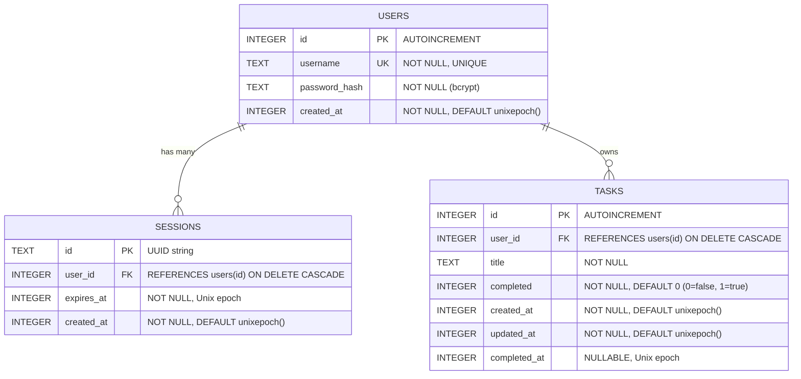

# Brain Database Design & Schema Specification

This document details the database architecture for the **Brain Backend** on **Cloudflare D1** (Serverless SQLite at the edge).

---

## 1. Entity-Relationship (ER) Diagram



### Visual Relationship Map (ASCII)
```text
  ┌───────────────────────┐
  │         users         │
  ├───────────────────────┤
  │ id (PK)               │
  │ username (UNIQUE)     │
  │ password_hash         │
  │ created_at            │
  └──────────┬────────────┘
             │
             ├──────────────────────────┐
             │ 1 : N                    │ 1 : N
             │ (CASCADE DELETE)         │ (CASCADE DELETE)
             ▼                          ▼
  ┌───────────────────────┐  ┌───────────────────────┐
  │       sessions        │  │         tasks         │
  ├───────────────────────┤  ├───────────────────────┤
  │ id (PK, UUID)         │  │ id (PK)               │
  │ user_id (FK)          │  │ user_id (FK)          │
  │ expires_at            │  │ title                 │
  │ created_at            │  │ completed (0 / 1)     │
  └───────────────────────┘  │ created_at            │
                             │ updated_at            │
                             │ completed_at          │
                             └───────────────────────┘
```

---

## 2. Table Specifications

### 2.1 `users` Table
Stores authenticated user accounts.

| Column | Type | Constraints | Description |
| :--- | :--- | :--- | :--- |
| `id` | `INTEGER` | `PRIMARY KEY AUTOINCREMENT` | Unique user identifier. |
| `username` | `TEXT` | `NOT NULL UNIQUE` | Lowercase sanitized username. |
| `password_hash` | `TEXT` | `NOT NULL` | `bcrypt-ts` hash with 10 salt rounds. |
| `created_at` | `INTEGER` | `NOT NULL DEFAULT (unixepoch())` | Account creation timestamp (epoch seconds). |

---

### 2.2 `sessions` Table
Stores active session tokens for cookie-based authentication.

| Column | Type | Constraints | Description |
| :--- | :--- | :--- | :--- |
| `id` | `TEXT` | `PRIMARY KEY` | Cryptographically random UUID (`crypto.randomUUID()`). |
| `user_id` | `INTEGER` | `NOT NULL`, FK ➜ `users(id)` | User owning the session. Cascades on delete. |
| `expires_at` | `INTEGER` | `NOT NULL` | Session expiry timestamp (epoch seconds). |
| `created_at` | `INTEGER` | `NOT NULL DEFAULT (unixepoch())` | Session creation timestamp (epoch seconds). |

**Indexes:**
- `idx_sessions_user_id` on `sessions(user_id)` — fast lookup when clearing user sessions during login.

---

### 2.3 `tasks` Table
Stores user todo items for the execution system.

| Column | Type | Constraints | Description |
| :--- | :--- | :--- | :--- |
| `id` | `INTEGER` | `PRIMARY KEY AUTOINCREMENT` | Unique task identifier. |
| `user_id` | `INTEGER` | `NOT NULL`, FK ➜ `users(id)` | Task owner. Cascades on delete. |
| `title` | `TEXT` | `NOT NULL` | Task description/title. |
| `completed` | `INTEGER` | `NOT NULL DEFAULT 0` | Completion flag (`0` = incomplete, `1` = completed). |
| `created_at` | `INTEGER` | `NOT NULL DEFAULT (unixepoch())` | Creation timestamp (epoch seconds). |
| `updated_at` | `INTEGER` | `NOT NULL DEFAULT (unixepoch())` | Last modification timestamp (epoch seconds). |
| `completed_at` | `INTEGER` | `NULLABLE` | Timestamp when marked completed, `NULL` otherwise. |

**Indexes:**
- `idx_tasks_user_id` on `tasks(user_id)` — ensures fast filtering when fetching a user's task list.

---

## 3. Data Integrity & Design Decisions

### 3.1 Foreign Keys & Cascading Deletes
Both `sessions` and `tasks` specify:
```sql
FOREIGN KEY (user_id) REFERENCES users(id) ON DELETE CASCADE
```
- If a user account is deleted, all their associated sessions and tasks are automatically wiped by SQLite, preventing orphaned rows.

### 3.2 Timestamps: Unix Epoch Integers
- Timestamps are stored as standard 64-bit Unix timestamps (`INTEGER`) generated via SQLite's native `unixepoch()`.
- **Why Epoch over ISO Strings?**
  - Extremely efficient storage (8 bytes vs 24+ character strings).
  - Fast, index-friendly numerical sorting (`ORDER BY created_at DESC`).
  - Trivial date math (`expires_at > unixepoch()`).

### 3.3 Boolean Representation
- SQLite has no native `BOOLEAN` type. Booleans are stored as `INTEGER`:
  - `0`: Incomplete / False
  - `1`: Completed / True

---

## 4. Query Patterns

### Authentication: Session Validation
```sql
SELECT u.id, u.username
FROM sessions s
JOIN users u ON s.user_id = u.id
WHERE s.id = ? AND s.expires_at > unixepoch();
```

### Tasks: Phase 1 Ordered Fetch
Incomplete tasks must always appear above completed tasks; within each group, newest first:
```sql
SELECT id, title, completed, created_at, updated_at, completed_at
FROM tasks
WHERE user_id = ?
ORDER BY completed ASC, created_at DESC;
```

### Maintenance: Purge Expired Sessions
```sql
DELETE FROM sessions WHERE expires_at < unixepoch();
```
