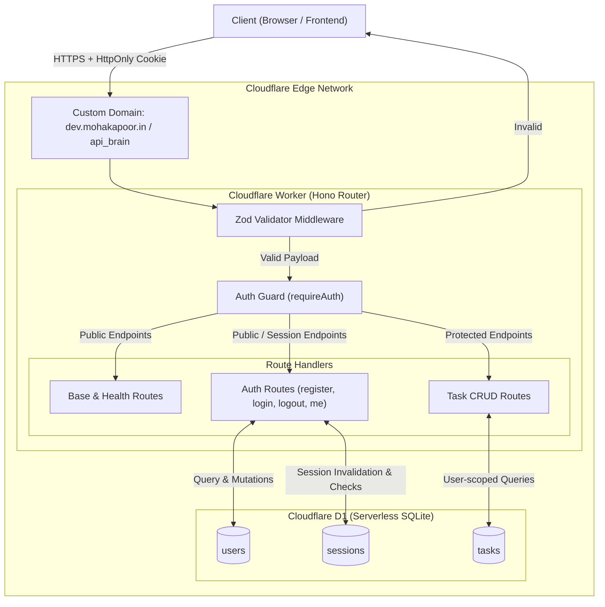

# Brain Backend — Architecture & System Design

This document details the architectural blueprint, design decisions, and core subsystems of the **Brain Backend** service.

For endpoint specifications, see [api_design.md](file:///c:/Users/mohak/OneDrive/Documents/Projects/brain/brain_backend/docs/api_design.md).  
For database schema and ER diagrams, see [db_design.md](file:///c:/Users/mohak/OneDrive/Documents/Projects/brain/brain_backend/docs/db_design.md).

---

## 1. System Overview & Philosophy

The Brain Backend is the persistence and logic layer for the **Personal Second Brain & Execution System**. It is designed around four foundational principles:

1. **Edge-Native Serverless Execution:** Runs on Cloudflare Workers across global edge locations with sub-millisecond cold starts and ultra-low latency.
2. **Zero In-Memory Session Dependency:** The backend is completely stateless at the compute layer; all authentication and domain state resides in Cloudflare D1 (SQLite at the edge).
3. **Strict Multi-Tenant Isolation:** Every data mutation and retrieval is strictly partitioned by `user_id` authenticated through server-side session lookup.
4. **Declarative Validation & Fail-Fast:** All inputs pass through compile-time and runtime Zod validation gates before reaching business logic.

---

## 2. Technology Stack & Rationale

| Layer | Technology | Rationale & Selection Criteria |
| :--- | :--- | :--- |
| **Edge Runtime** | Cloudflare Workers | V8 isolate-based serverless compute; near-zero cold starts, global distribution, and native binding to Cloudflare storage. |
| **Routing & Middleware** | Hono (`^4.x`) | Ultrafast, lightweight, fully typed web framework tailored for Cloudflare Workers with first-class cookie and middleware support. |
| **Edge Database** | Cloudflare D1 | Serverless SQLite co-located with Workers; provides native ACID transactions, relational foreign key constraints, and zero network transit latency. |
| **Validation Engine** | Zod (`^4.x`) + `@hono/zod-validator` | Declarative request payload schemas with automatic trimming, sanitization, and structured error responses. |
| **Password Hashing** | `bcrypt-ts` (`^9.x`) | Pure TypeScript WebCrypto-compatible implementation of bcrypt that executes reliably inside Cloudflare Workers V8 isolates without native Node bindings. |
| **Deployment & CI/CD** | Cloudflare Wrangler + GitHub Actions | Automated lint/typecheck (`tsc --noEmit`), automated D1 migrations, and single-click continuous deployment. |

---

## 3. High-Level Architecture Diagram



---

## 4. Core Subsystems & Request Lifecycle

### 4.1 Request Pipeline & Middleware Chain

All HTTP requests follow a strict sequential pipeline:
1. **Global Prefix Mount (`/api_brain`):** All service routes are mounted under the `/api_brain` namespace.
2. **Input Validation (`zValidator`):** Incoming JSON bodies are parsed and validated against declarative Zod schemas (`src/schemas/*`). Invalid payloads immediately abort with `400 Bad Request`.
3. **Session Authentication (`requireAuth`):** Protected routes (`/tasks/*`) extract the `session_id` cookie, query D1 `sessions` joined with `users`, verify expiry, and inject the authenticated user profile into the Hono context (`c.set('user', user)`).
4. **Business Logic Execution:** Route handlers perform atomic D1 prepared statement operations.
5. **Response Serializer:** Returns standard JSON structures with appropriate HTTP status codes (`200`, `201`, `401`, `403`, `404`, `409`, `500`).

---

### 4.2 Authentication & Session Architecture

```mermaid
sequenceDiagram
    autonumber
    actor Client as User / Browser
    participant Worker as Cloudflare Worker
    participant D1 as Cloudflare D1

    Client->>Worker: POST /api_brain/auth/login { username, password }
    Worker->>D1: SELECT id, password_hash FROM users WHERE username = ?
    D1-->>Worker: user record
    Worker->>Worker: bcrypt compare password
    Worker->>D1: DELETE FROM sessions WHERE user_id = ? (Single-device policy)
    Worker->>D1: INSERT INTO sessions (id, user_id, expires_at) VALUES (uuid, ...)
    Worker-->>Client: 200 OK + Set-Cookie: session_id=<UUID>; HttpOnly; Secure; SameSite=Lax
```

- **Session Identification:** Opaque UUID (`crypto.randomUUID()`) issued upon login/registration.
- **Client Storage:** `HttpOnly`, `Secure`, `SameSite=Lax`, `Path=/` cookie. Inaccessible to client JavaScript, mitigating XSS token theft.
- **Server Persistence:** Stored in `sessions` table with an absolute expiration (`expires_at`).
- **Single-Device Policy:** A successful login purges any prior active sessions for that user ID.
- **Dual Invalidation:** Logout purges the database row from D1 AND sends an expired `Set-Cookie` header to wipe the browser cookie.

---

### 4.3 Task Management & Multi-Tenancy

Every task belongs exclusively to the user identified by the session:
- **Tenant Scoping:** SQL queries always include `WHERE user_id = ?` bound to the authenticated user ID.
- **Ordering Guarantee:** Listing tasks returns incomplete tasks first, sorted by newest created (`ORDER BY completed ASC, created_at DESC`).
- **Audit Timestamps:**
  - `created_at`: Set on creation (`unixepoch()`).
  - `updated_at`: Updated on any field modification (`unixepoch()`).
  - `completed_at`: Populated with `unixepoch()` when `completed` becomes `1`; cleared to `NULL` when undone.

---

## 5. Security & Isolation Model

1. **Invite-Only Registration:** Controlled by `INVITE_CODE` environment secret. Registrations with invalid codes are rejected with `403 Forbidden`.
2. **Environment Secret Separation:**
   - Secrets (`INVITE_CODE`) are provided via `.dev.vars` locally and GitHub Secrets in CI/CD.
   - Non-sensitive variables (`SESSION_TTL_SECONDS`) are defined in deployment configuration.
   - Plaintext secrets are strictly excluded from git tracking.
3. **Database Cascading Integrity:** Foreign keys enforce `ON DELETE CASCADE`. If a user is deleted, all their sessions and tasks are automatically wiped by SQLite.
4. **Parameterized Prepared Statements:** All SQL queries use D1 parameter binding (`?`), eliminating SQL injection vulnerabilities.

---

## 6. Continuous Deployment & Delivery (CI/CD)

The backend employs an automated GitHub Actions deployment pipeline (`.github/workflows/deploy.yml`):

1. **Path Filtering:** Uses `dorny/paths-filter@v3` to ensure builds only trigger when code (`src/**`), migrations (`migrations/**`), or dependency manifests change.
2. **Automated Static Verification:** Executes `npx tsc --noEmit` to ensure zero type errors.
3. **Automated Migration Application:** Executes `wrangler d1 migrations apply` against the remote environment database before code deployment.
4. **Atomic Worker Deployment:** Deploys the minified worker to Cloudflare Workers bound to `dev.mohakapoor.in`.
